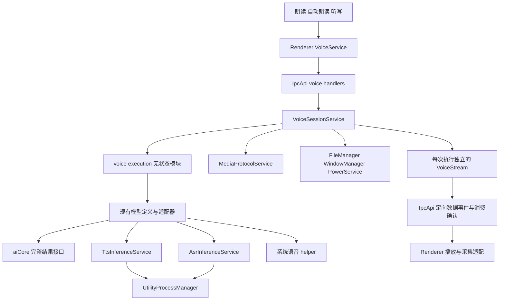
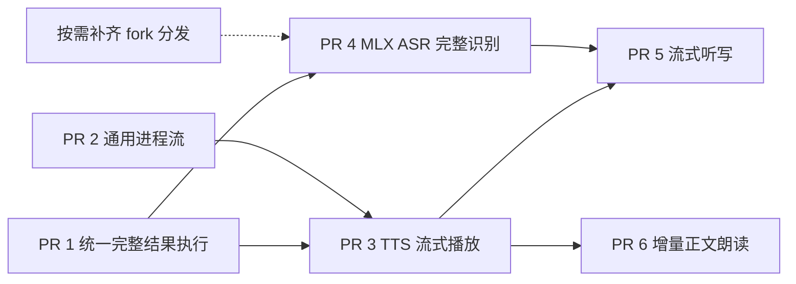

# TTS 与 ASR 统一接口和流式执行方案

状态：设计提案。源码基线：`9d1bf05fe2c`。本方案承接 [#21662](https://github.com/CherryHQ/cherry-studio/issues/21662) 的语音执行与播放边界，以及 [#21668](https://github.com/CherryHQ/cherry-studio/issues/21668) 的模型与引擎解耦。

目标是让朗读、自动朗读和听写通过统一接口使用不同语音后端。模型适配器负责 MLX、Sherpa、系统语音和后续云端协议的差异；上层根据明确的输入输出能力选择操作。统一能力描述、执行结果、取消和释放语义，同时保留完整音频与连续音频的区别。

首个流式实现使用已有 Qwen3-TTS。ASR 在同一会话和传输边界下接入连续 PCM 与文本修订。首期保持现有跨窗口语音互斥，不增加双向 Realtime 对话、多个模型并行驻留、插件注册系统或新的全局语音管理服务。

## 当前调用关系与需要改变的边界

| 当前入口 | 已有行为 | 需要改变的地方 |
| --- | --- | --- |
| `VoiceSessionService` | 管理 admission、窗口归属、配置、取消、临时文件、播放状态和资源操作 | 保持会话所有权，持有统一执行句柄与流传输对象 |
| `AiService.generateSpeech/transcribe` | 创建本地 SDK 模型，再调用 aiCore 的完整结果接口 | 当前生产调用者只有 `VoiceSessionService`；将这两段执行逻辑迁入语音模块，删除迁移后无调用者的包装 |
| `localAdapters.ts` 与 `voiceModelTypes.ts` | 统一模型定义、平台支持、安装状态和音色，但执行契约仅有 SDK `createModel` | 在同一份模型定义中增加操作能力和执行入口，不另建模型注册表 |
| `TtsInferenceService` | 隔离推理、模型选择、串行执行、取消和卸载 | 增加流式输出，保持同一个模型使用与卸载屏障 |
| `inferenceTtsHandlers.ts` | 已调用 `synthesizeStream`，经语速处理后全部写入 WAV | 增加逐块 PCM 消费路径，停止将流式请求聚合为完整 WAV |
| `AsrInferenceService` | Sherpa FunASR 离线识别，完整音频内做 VAD 分段 | 保留完整输入路径，新增连续输入的实际模型适配 |
| `SpeechPlaybackService` | 等待完整媒体 URL，使用 `HTMLAudioElement` 播放 | 在同一协调器下容纳有限媒体与 PCM 两种输出 |
| `DictationService` | `MediaRecorder` 收集完整录音，识别完成后插入文本 | 增加 PCM 采集和修订预览，最终插入继续使用 `VoiceTargetManager` |

现有 [aiCore 语音接口](../../../packages/aiCore/src/core/runtime/voice.ts) 是完整结果包装；[模型定义](../../../src/main/ai/voice/voiceModelTypes.ts) 和 [播放状态](../../../src/main/ai/voice/playbackState.ts) 是本次演进的直接边界。

## 服务依赖与生命周期

### 依赖方向

图中的实线表示调用或模块依赖，不代表每个节点都需要注册为生命周期服务。



`execution.ts` 负责解析适配器、验证能力并创建执行句柄，不保存全局会话、进程、计时器或连接，因此使用普通函数模块。执行中的异步任务和临时资源属于执行句柄，句柄由 `VoiceSessionService` 持有。模型缓存与进程仍归现有推理服务和 `UtilityProcessManager`。

不新增 `VoiceRuntimeService`、`VoiceTransportService` 或 `VoiceModelManager`。`VoiceStream`、`PcmPlayback`、`PcmCapture` 是按会话创建的资源对象，不是单例，不加 `Service` 后缀，也不进入 `serviceRegistry.ts`。

### 生命周期依赖表

| 服务 | 阶段 | 方案中的同阶段依赖与职责 |
| --- | --- | --- |
| `LocalModelService` | `BeforeReady` | 保持安装、校验、状态与共享运行时回收；移除模型时调用现有 capability hook |
| `UtilityProcessManager` | `WhenReady` | 保持通用进程启动、请求关联、退出确认和协议生命周期，不依赖语音服务 |
| `TtsInferenceService` / `AsrInferenceService` | `WhenReady` | 继续通过 `InferenceServiceBase` 依赖 `UtilityProcessManager`；按执行生命周期占用推理队列 |
| `VoiceSessionService` | `WhenReady` | 用 `TtsInferenceService`、`AsrInferenceService` 替换 `AiService` 依赖；保留 `FileManager`、`WindowManager`、`UtilityProcessManager`、`PowerService`、`MediaProtocolService` |
| `AiService` | `WhenReady` | 语音调用迁出后不反向依赖 `VoiceSessionService`；原有聊天、MCP 和 Job 依赖保持原职责 |

`VoiceSessionService` 仍直接依赖 `UtilityProcessManager`，因为它当前在 `onInit` 注册 `voice.audio` 解码进程。文件处理仍经 `FileManager`，所以这并不意味着完全移除语音对 Job 基础设施的间接依赖。

`PreferenceService`、`CacheService`、`IpcApiService` 和 `LocalModelService` 位于更早阶段，不为它们增加 WhenReady 服务的 `@DependsOn`。派生推理服务如需增加依赖，必须保留基类的 `UtilityProcessManager` 依赖；当前装饰器覆盖规则不能当作自动合并。

`LocalModelService` 的移除 hook 是就绪后的运行期回调，不是初始化时依赖 WhenReady 服务。保持 `LocalModelService → inference.removeModelThen` 的维护路径，不增加 `LocalModelService → VoiceSessionService` 的反向依赖。

### 停止与卸载

正常停机顺序为：语音会话停止接收请求并清理执行 → 推理消费者收尾 → `UtilityProcessManager` 确认子进程退出。生命周期容器按初始化逆序发起停止，但单服务超时后会继续停止后续服务，因此不能仅靠装饰器假定清理已成功。

每次关闭操作先使当前执行身份失效，停止音频发送与新输入，再取消生产、拒绝等待中的读写并等待释放。停止、窗口关闭、锁屏、进程退出和重复回调都必须幂等。运行中清理失败时保留现有不可用状态与恢复路径；应用停机则向生命周期系统报告失败或超时，不伪装成正常释放。

推理队列的占用从开始执行持续到取消或正常完成后的资源清理结束，不能在返回流句柄时释放。暂停播放只停止消费，不释放模型使用权。`removeModelThen(modelId, ...)` 必须能够唤醒正在等待背压的任务，等待进程退出后才删除文件。卸载未使用的 A 不打断 B；共享运行时在仍有模型引用时保留。

## 统一执行契约

### 能力由模型定义提供

保留现有模型的音频生成、转录分类；新增语音操作能力，表达允许的输入输出组合。不要使用一个 `streaming: boolean`，也不要让独立布尔值产生后端实际不支持的组合。

能力标签使用常量对象与派生类型，统一定义在 `src/shared/ai/voice.ts`。字符串值用于跨进程序列化，调用方使用具名成员，避免在适配器、消费者与校验规则中重复书写字符串。标签只描述输入输出的种类，实际文本和音频由对应请求及结果承载。

```ts
export const SpeechInputKind = {
  Text: 'text',
  TextStream: 'text_stream'
} as const
export type SpeechInputKind = (typeof SpeechInputKind)[keyof typeof SpeechInputKind]

export const SpeechOutputKind = {
  Audio: 'audio',
  PcmStream: 'pcm_stream'
} as const
export type SpeechOutputKind = (typeof SpeechOutputKind)[keyof typeof SpeechOutputKind]

export const TranscriptionInputKind = {
  Audio: 'audio',
  PcmStream: 'pcm_stream'
} as const
export type TranscriptionInputKind = (typeof TranscriptionInputKind)[keyof typeof TranscriptionInputKind]

export const TranscriptionOutputKind = {
  Final: 'final',
  Segments: 'segments',
  Revisions: 'revisions'
} as const
export type TranscriptionOutputKind = (typeof TranscriptionOutputKind)[keyof typeof TranscriptionOutputKind]

interface VoiceCapabilities {
  speech?: readonly {
    input: SpeechInputKind
    output: SpeechOutputKind
  }[]
  transcription?: readonly {
    input: TranscriptionInputKind
    output: TranscriptionOutputKind
  }[]
}

const qwenSpeechCapabilities = {
  speech: [
    { input: SpeechInputKind.Text, output: SpeechOutputKind.Audio },
    { input: SpeechInputKind.Text, output: SpeechOutputKind.PcmStream }
  ]
} as const satisfies VoiceCapabilities
```

IpcApi schema 引用同一常量对象建立枚举校验，路由类型继续从 schema 推导，不维护第二份字符串列表。`SpeechSource.kind` 等判别字段也引用对应常量成员的类型；MIME 等固定协议格式仍可使用字面量约束。能力数组逐项声明实际支持的组合，不能将全部输入与全部输出自动做笛卡尔积。

能力是可执行操作的描述，安装状态、系统支持和授权状态继续分别报告。Main 校验请求组合；Renderer 只依据能力选择录音、预览和播放流程，不依据操作系统、模型名称或引擎 ID 分支。

| 适配路径 | 首期对外能力 |
| --- | --- |
| 现有系统 TTS 与 Kokoro | 完整文本 → 完整音频 |
| Qwen3-TTS MLX | 完整文本 → PCM 流；完整音频路径保留 |
| 现有系统 ASR 与 FunASR | 完整音频 → 最终文本 |
| 后续 MLX Qwen3-ASR | 连续 PCM → 文本修订与最终结果，完成打包和实机验证后开放 |
| 后续 FunASR VAD 连续模式 | 连续 PCM → 已完成分段；不能声明具有句内修订能力 |

增量文本输入待消费者接入后才开放。云端模型必须沿用既有 provider/endpoint 解析和凭据管理；本方案不提前注册尚未实现的云端能力，也不假定所有云端音频都能直接转换为 PCM。

### 进程内接口与跨进程数据分开

以下是 Main 内部的接口形状，具体请求和结果字段由实现阶段补全。它们放在 `src/main/ai/voice/executionTypes.ts`，不放入 `@shared`，不经 IPC 直接传递。

```ts
interface SpeechExecution {
  readonly output: Promise<SpeechSource>
  readonly completed: Promise<SpeechCompletion>
  readonly closed: Promise<void>
  cancel(): Promise<void>
}

type SpeechSource =
  | { kind: typeof SpeechOutputKind.Audio; audio: Uint8Array; mediaType: 'audio/wav' }
  | { kind: typeof SpeechOutputKind.PcmStream; format: PcmFormat; chunks: AsyncIterable<PcmChunk> }

interface TranscriptionExecution {
  readonly updates: AsyncIterable<TranscriptRevision>
  readonly completed: Promise<TranscriptResult>
  readonly closed: Promise<void>
  cancel(): Promise<void>
}
```

执行入口使用 `startSpeech(request, signal)` 与 `startTranscription(request, signal)` 两个函数。请求分别接受带判别字段的完整输入或异步输入源；TTS 文本流有显式 `flush`，输入迭代结束表示不再接受文本；ASR 输入迭代结束表示停止录音并请求最终识别。只关闭输入不会取消已经提交的工作。

统一语义如下：

- `output` 表示音频源已可消费。完整音频适配器需要等待合成，流式适配器只需完成格式与流准备。
- `completed` 表示生产端成功、失败或取消，独立于消费循环可观察；背压仍可能使正常完成等待消费推进。截断不能报告成功。
- `closed` 表示生产任务和执行器拥有的临时资源已收尾；失败会拒绝该 Promise。它不等待 Renderer 播放完毕，也不代表共享热模型已卸载。
- `cancel()` 幂等，停止输入和输出，唤醒等待者，并等待 `closed`；失败保持可观察。外部 signal 和提前退出迭代走同一个取消入口。
- 正常完成、失败、未开始迭代即取消，都必须使相关 Promise 和读写最终结算。会话创建句柄后立即观察其终态，避免依赖消费者恰好遍历才能发现错误。

适配器不创建媒体 URL、不广播 IPC、不操作 UI。完整音频交给 `VoiceSessionService` 存入 `MediaProtocolService`；PCM 源交给会话拥有的传输对象。`SpeechPlaybackService` 对两者提供相同的播放、暂停、停止和完成报告入口。

### 文本结果与音频格式

跨进程值类型放入 `src/shared/ai/voice.ts`；IpcApi 请求、事件和校验仍由 `src/shared/ipc/schemas/voice.ts` 定义，输入输出类型从 schema 推导。

- `PcmFormat`：采样率、声道数、固定首版编码 `f32`、交错声道布局。
- `PcmChunk`：流内序号、`startFrame` 和样本；帧数等于样本数除以声道数。所有偏移基于语速转换后的输出。
- `TranscriptRevision`：单调递增 `revision`、当前完整转录 `text`、可回改后缀的起点、`final`。后缀起点统一为 JavaScript UTF-16 偏移，不暴露厂商 token 下标。
- `VoiceOutputDescriptor`：有限媒体 URL 或 PCM 流的描述，以及会话、请求、播放 attempt 身份；不携带路径、SDK 实例或函数。

模型定义、解析后的配置和显示能力使用同一来源。每次执行冻结 `modelId`、音色、语言、语速以及内部 bundle/engine 解析结果；过程中修改设置只影响下一次执行。模型缺失或组合不支持时明确失败，不默默换模型。

ASR 适配器将厂商 delta、累计文本或分段结果转换为完整 revision；UI 替换当前预览，不追加重复文本。所谓 stable 前缀仍可能因后端修订而变化，真正不可变的提交点是最终结果。首版只在 `completed` 后通过原有目标绑定插入一次；输入框关闭或目标失效时沿用恢复流程，不能把文本写进后来获得焦点的输入框。长时间转录保持明确的输入时长与文本大小上限，不承诺无限录音时的全量文本内存恒定。

## 传输与背压

### Main 与 Renderer

首版沿用 IpcApi 的定向事件和带确认请求，不新增原生通道或 preload 专用语音桥。仓库的 [IPC escape hatch 规则](../ipc/ipc-migration-guide.md#escape-hatch--when-a-channel-may-stay-out) 不允许仅以高频为由将 Main → Renderer 数据绕出 IpcApi。

拟新增路由如下，均经过现有 sender 校验与 `VoiceSessionService` 的所有权检查：

| 路由或事件 | 作用 |
| --- | --- |
| `ai.voice.speech.start` | 接收输入方式和能力要求，准入后返回执行身份与输出描述 |
| `ai.voice.transcription.start` | 创建完整或连续识别执行 |
| `ai.voice.stream.attach` | Renderer 已安装接收器后确认准备就绪，并声明受 Main 上限约束的初始容量 |
| `ai.voice.stream.write` | 有界输入批次；用于 PCM，后续用于增量文本；限制每个流的在途请求数 |
| `ai.voice.stream.finish_input` | 输入结束，执行器处理尾部并正常完成；不等价于取消 |
| `ai.voice.stream.ack` | 报告累计已消费音频帧，单调、幂等，不能确认尚未发送的帧 |
| `ai.voice.stream_event` | 仅发送给 owner 的格式、PCM、文本 revision、EOF 或失败事件 |

暂停、恢复、停止、播放报告和 session discard 复用现有语义；新路由不并行建立另一套 admission。旧的 `ai.speech.generate`、`ai.transcription.generate` 在迁移期保留，并使用统一执行层的完整输入输出路径。

TTS 以播放器真实剩余容量限制发送。工作线程消费样本后释放额度，Main 才继续向推理进程拉取；预读、进程消息队列、Main 中继和 Renderer 队列的上限均计入总预算。不能在收到消息时就确认已播放，也不能用工作线程输出的欠载静音增加消费进度。PCM 数据不进入 Cache、不广播给所有窗口。

普通 mono 24 kHz float32 PCM 的数据率为 `24,000 × 4 = 96,000` 字节每秒，适合先用有界批次验证现有通道。批次时长和预缓冲是内部实现参数，验收记录冷启动、首音、欠载和总队列占用，再决定具体值，不先增加用户设置。

ASR 在音频线程采集、在 Renderer 普通线程聚合批次，按 Main 接收额度送入执行器。写入确认表示有界输入队列已接收，不表示该段已识别。采集不能阻塞硬件时钟；缓冲持续满时终止并报告输入过载，不静默丢帧或无限堆积。停止录音应先送完已接受的尾部帧再 `finish_input`；取消则丢弃未提交输入。

只有实测显示现有传输无法达到目标时，才提出 IpcApi 基础层的 MessagePort 扩展，同时更新 IPC 规范与身份绑定方案。Electron 的 [MessagePort 交接](https://www.electronjs.org/docs/latest/tutorial/message-ports) 需要 `postMessage`，不能直接塞进当前 `invoke` 返回值。这个选择影响传输实现，不改变语音执行接口。

### Main 与独立推理进程

现有 `UtilityProcessMethod` 支持增量事件，但 `emit` / `onEvent` 是同步回调，没有输入流、消费等待和信用额度。先在 `core/utilityProcess` 增加一个可选的请求级有界流能力；现有 `request()` 和普通事件语义保持不变。

该增量能力只负责请求关联、双向有界数据帧、输入 EOF、输出 EOF、终态与取消。向消费者暴露可等待的读写或迭代器，向 handler 暴露输入迭代器及可等待输出；阻塞只等待容量，不阻塞取消。限制按字节和帧数计量，不包含采样率、音色、模型或播放状态等业务字段。

流仍属于一个活跃请求，直到终态与清理完成；等待输入或消费不应被误判为进程空闲。进程崩溃、维护停机或请求取消时，关闭全部关联流并拒绝等待者。保持现有 generation/tombstone 防护，终态重复和旧代事件不能重新打开流。

这是通用进程模块的上游扩展。语音 handler 不另建消息端口、私有 ACK RPC 或第二套请求映射来绕过框架。`InferenceServiceBase` 随后增加整次流执行的队列占用，复用原有模型切换、取消和卸载屏障。首期保留本地推理的 terminate 取消策略；是否切换 cooperative 取消需要另外证明原生调用始终可退出。

## 播放和录音的所有权

`SpeechPlaybackService` 保持唯一 Renderer 播放协调器，内部按输出描述创建 `FinitePlayback` 或 `PcmPlayback`。两者提供相同的暂停、恢复、停止、排空和失败报告。`PcmPlayback` 拥有 AudioContext、AudioWorklet 与有界队列；工作线程只处理音频，不发 IPC、不解析业务配置。

播放状态继续分为 `synthesis`、`desired`、`observed`。当前 `completePlaybackSynthesis()` 在生成结束时才增加 `attemptId`；流式路径必须在输出源发布前分配 attempt，之后生成完成仅更新 synthesis，不能把已经 playing/paused 的 observed 重置为 ready。`ended` 仅在 EOF 且队列排空后报告。

停止时先让 Renderer 本地输出失效并清空队列，再等待 Main 取消与释放；旧 session/request/attempt 的数据全部拒绝。Main 不在仅收到生产 EOF 后释放会话，必须处理播放排空或取消后的释放。慢速播放、暂停时的等待不能沿用当前固定合成总超时而误报超时；准备、模型执行、输入空闲和消费暂停分别定义预算，暂停不消耗有效生成预算。

`DictationService` 拥有录音设备和 `PcmCapture`，以实际设备采样率标记 PCM。模型适配器在明确的输入边界完成所需重采样；播放端按源格式与 AudioContext 实际采样率做明确转换。优先复用现有可流式处理的库能力，转换尾部状态必须 flush；不在多个层重复改变语速或采样率。浏览器 [AudioWorklet](https://developer.mozilla.org/en-US/docs/Web/API/AudioWorklet) 用于音频线程处理，不能把推理或同步等待放进其回调。

长文本不能保持“当前段播放 ended 才提交下一段”的调度，否则流式只减少每段内部等待。有限文本的段落调度放在同一 speech execution 内，保留 `readableText` 的内容规范化与长度确认；增量文本模式复用同一条输入流，不再叠加另一层播放结束驱动的分段器。

## 文件组织与模块边界

以下“新增”表示实现阶段的候选文件，不在方案阶段创建空目录或骨架。沿用现有 `ai/voice`、`ai/localModel`、`services/voice`，不新建进程根目录，不搬迁整个语音模块。

| 位置 | 动作与责任 |
| --- | --- |
| `src/main/ai/voice/VoiceSessionService.ts` | 修改：唯一会话所有者，持有 execution/transport，编排释放 |
| `src/main/ai/voice/execution.ts` | 新增：`startSpeech` / `startTranscription`，模型能力校验与适配器选择，无全局状态 |
| `src/main/ai/voice/executionTypes.ts` | 新增：Main 内的请求、source、execution 类型 |
| `src/main/ai/voice/VoiceStream.ts` | 新增：每次执行的有界中继、额度、输入结束与传输清理；由 session 创建 |
| `src/main/ai/voice/localAdapters.ts` | 修改：继续作为本地模型定义解析入口，不再新增平行 registry |
| `src/main/ai/voice/voiceModelTypes.ts` | 修改：模型定义声明能力和启动操作；安装、语言与音色继续同源 |
| `src/main/ai/voice/localAdapters/*.ts` | 修改：包装现有 SDK 完整结果，或创建引擎流执行；错误映射留在适配器 |
| `src/main/ai/voice/playbackState.ts` | 修改：提前分配 attempt，允许生成与播放同时进行，区分 EOF 与 drained |
| `src/main/ai/localModel/capabilities/{tts,asr}/` | 修改：推理入口、protocol、模型路径与能力对应，不持有窗口状态 |
| `src/main/ai/localModel/runtime/InferenceServiceBase.ts` | 修改：流执行全程串行占用，保持模型切换与卸载屏障 |
| `src/main/ai/localModel/runtime/utilityEntries/` | 修改：实际引擎读写与增量结果；新增 MLX ASR 时按现有 entry 约定构建 |
| `src/main/core/utilityProcess/{types.ts,protocol,host,runtime}` | 修改：通用有界流协议；不导入 voice 类型或业务模块 |
| `src/main/ipc/handlers/voice.ts` | 修改：schema 后委派服务，保持薄 handler |
| `src/shared/ai/voice.ts` | 新增：真正跨进程使用的能力、PCM、转录修订和输出描述值类型 |
| `src/shared/ai/localVoice.ts` | 修改：现有本地模型描述引用统一能力；保留既有 ID |
| `src/shared/ipc/schemas/voice.ts` | 修改：请求与事件的单一契约来源；公共数据帧也要校验大小、格式与顺序 |
| `src/renderer/services/voice/VoiceService.ts` | 修改：执行启动、事件订阅、输入与消费确认，不负责播放实现 |
| `src/renderer/services/voice/SpeechPlaybackService.ts` | 修改：协调有限媒体与 PCM 输出，继续服务朗读和试听 |
| `src/renderer/services/voice/{FinitePlayback,PcmPlayback}.ts` | 提取 / 新增：输出资源对象，由播放协调器创建，无单例 |
| `src/renderer/services/voice/{PcmCapture,DictationService}.ts` | 新增 / 修改：设备采集、输入额度、修订预览与最终提交 |
| `src/renderer/services/voice/pcmPlaybackProcessor.ts`、`pcmCaptureProcessor.ts` | 新增：AudioWorklet 入口；作为独立浏览器资源构建，不经过含服务副作用的 barrel |
| `src/main/core/application/serviceRegistry.ts` | 不新增语音 service；核对现有类型注册仍覆盖依赖 |
| `src/preload/ipc.ts` | 首版保持通用桥，无语音专用分支 |
| `packages/aiCore/src/core/runtime/voice.ts` | 保留现有无 Electron 的完整结果 API；由适配器调用，不搬入会话、IPC 或模型安装 |

新增 Main 文件使用具名文件导入，不为 `ai/voice` 仓促增加聚合 barrel；Renderer 继续使用已有 `services/voice/index.ts`，只公开消费者需要的服务和类型，播放、采集与工作线程保持私有。`localModel/index.ts` 只按实际外部消费者补充必要导出；不从外部深导入它的 protocol。规则依据 [命名规范](../architecture/naming-conventions.md#64-barrel--index-files)。

aiCore 不是应用服务的依赖容器。首版统一接口放 Main，是因为会话与本地执行适配的当前消费者在 Main；将来若桌面和移动端真正共用执行协议，再提取纯运行时契约到独立包。不能让 `packages/aiCore` 反向导入 `src/shared`、`@application` 或 Cherry 的模型安装服务。

## 分批实施与验收

| 批次 | 改动范围 | 必须证明的结果 |
| --- | --- | --- |
| A 统一完整结果接口 | 模型能力、execution 契约、现有适配器包装；迁出 `AiService` 语音方法；补齐服务依赖 | 同一套调用覆盖已有 TTS/ASR；音色语言语速保持；取消前后模型使用和临时文件正确释放；既有朗读听写行为不变 |
| B 通用有界流与 Qwen3-TTS | utility-process 上游流能力、推理租约、IpcApi 批次与消费确认、PCM 播放 | 未完成生成时已经播放；各级缓冲有界；EOF 不截尾；暂停恢复不重复；停止后迟到帧不发声；worker 崩溃后能启动新会话 |
| C 连续 ASR | PCM 采集、连续输入、MLX ASR 适配、文本修订 | 输入有界且无静默丢帧；中间结果可修订；尾部正确 flush；最终仅插入一次；焦点切换不误写；取消后无旧结果 |
| D 增量文本及其他后端 | LLM 稳定正文输入，按真实模型选择 Sherpa 在线或 VAD 分段适配 | 文本输入结束与音频结束分离；不读 reasoning；无重复提交；新后端无需修改业务消费者的引擎分支 |

ASR 批次需要补齐模型包、JS API 和原生运行时版本匹配。fork 的 [Qwen3-ASR 流接口](https://github.com/CherryHQ/mlx-node/blob/f4c21043f557965345b527bc04179ad26d08378f/packages/asr/README.md) 提供滚动输入与文本修订，但当前 TTS 打包成功不等于 ASR 的交付链已验证。多模型改造继续遵循 [Local Models](./local-models.md) 的安装和共享运行时边界，不能将默认 capability 映射当成用户本次选择。

每批先用 `pnpm check --plan` 查看影响范围，再选显式测试文件；不执行无过滤的全仓库测试。现有回归入口包括：

- Main：`src/main/ai/voice/__tests__/VoiceSessionService.test.ts`、`playbackState.test.ts`、`voiceAdmissionCoordination.test.ts`，以及 `src/main/ipc/handlers/__tests__/voice.test.ts`。
- Adapter：`src/main/ai/voice/localAdapters/__tests__/{apple,windows,funasr,qwen3Tts}.test.ts` 与 `src/main/ai/localModel/runtime/__tests__/{InferenceServiceBase,inferenceEntryTts}.test.ts`。
- 进程：`src/main/core/utilityProcess/__tests__/ProcessHost.cancellation.test.ts`、`ProcessHost.stop.test.ts`、`serveUtilityProcess.test.ts`，加有界流的新契约测试。
- Renderer：`src/renderer/services/voice/__tests__/{VoiceService,SpeechPlaybackService,DictationService,AutoReadService,VoiceTargetManager}.test.ts`，加 PCM 输出和采集的新测试。
- aiCore：迁移完整结果包装时执行 `packages/aiCore/src/core/runtime/__tests__/voice.test.ts`；移走原 `AiService.voice.test.ts` 中仍有效的契约断言。

新测试必须能捕获实际失效：容量越界、重复样本、尾音丢失、暂停误超时、停止后复活、卸载竞争、最终文本重复插入或跨窗口越权。Frontend 测试遵循 [前端测试指南](../testing/frontend-testing.md)，依赖替身遵循 [统一 mock 规则](../../../tests/__mocks__/README.md)。

真实 Electron 验证单独记录首次可听延迟、源帧与消费帧连续性、欠载次数、峰值队列占用、暂停稳定性、冷/热启动和取消后重新执行；覆盖开发与打包资源路径。历史首块 PCM 数据只证明引擎输出，不替代扬声器首音、流式播放或 ASR 实机验收。

## PR 拆分与依赖

每个 PR 的类与接口、文件清单、资源释放顺序、类型约束和验收项见 [逐 PR 实现方案](./voice-streaming-implementation.md)。本节保留交付范围与依赖总览；实现方案中的新增符号均为提案，不代表已经实现。

建议拆为六个 Cherry Studio 实现 PR；MLX ASR 的发布产物若需要补齐，另有一个 `CherryHQ/mlx-node` 配套 PR。这是评审与交付划分，不要求一次创建全部分支。当前设计文档可以随 PR 1 提交；若需要先独立评审架构，再单开 docs PR。

| PR | 建议标题 | 范围 | 依赖 | 独立验收 |
| --- | --- | --- | --- | --- |
| 1 | `refactor(voice): unify speech and transcription execution` | 常量与能力契约、统一执行句柄、完整结果适配；迁出 `AiService` 语音方法，补齐生命周期依赖。只声明本 PR 真正可执行的能力 | 无 | 现有系统语音、FunASR、Qwen3-TTS、Kokoro 的完整结果路径经过统一入口；选择、取消、文件释放和错误语义保持正确 |
| 2 | `feat(utility-process): support bounded request streams` | 通用请求级输入输出流、容量控制、EOF、取消和进程退出结算；保持原 request/event 接口兼容。流量控制不携带 voice 业务语义 | 无硬性代码依赖；接口与 PR 1、3 对齐 | 真实 Electron 子进程中，慢消费和输入过载均有界，取消唤醒阻塞读写，退出后旧代帧无效，现有请求不受影响 |
| 3 | `feat(voice): stream Qwen3 speech to playback` | TTS producer、推理执行全程占用、Main 会话与 IpcApi 流控、Renderer PCM 输出、播放状态迁移；有限媒体输出适配随真实消费者一起提取 | 1、2 | 试听与朗读在生成结束前出声；暂停、恢复、排空、停止、跨窗口仲裁、卸载和 worker 崩溃恢复通过；打包后的 AudioWorklet 可用 |
| 4 | `feat(local-asr): add MLX Qwen3 transcription` | MLX ASR 的模型定义、包依赖、原生版本校验、模型下载与选择、完整音频识别适配。复用现有资源管理，不改流式听写 UI | 1；必要时依赖配套引擎发布 | 下载后可选择并识别；与 FunASR 切换不串模型；缺少选中模型时明确失败；取消、卸载、国内外源及打包加载正确，TTS 共用运行时无回归 |
| 5 | `feat(voice): support streaming dictation` | 连续 PCM 采集、输入写入与结束、Qwen3-ASR stream、转录修订与最终提交；复用 PR 3 的身份、传输和清理规则 | 2、3、4 | 边录边更新预览；无静默丢帧；正常停止保留尾部；取消不提交；文本只插入一次且不误写其他输入框 |
| 6 | `feat(voice): read incremental assistant text` | 将稳定可朗读正文提交到同一 speech execution，支持文本 flush 和输入结束；调整自动朗读调度，复用已有音频输出 | 3 | 回答未结束时可朗读；排除 reasoning；无重复文本和双重分段；暂停、输入结束、失败和中途打断正确 |



PR 2 与 PR 3 应先在同一验证分支跑通真实 Qwen3-TTS，再按基础设施与业务边界拆开评审，合并顺序为 2 → 3。PR 2 不以测试替身通过作为结束条件，也不为后续模型预建插件、调度或进程池接口。PR 3 保持从 producer 到播放器的完整交付，避免单独合并没有真实消费者的 PCM 播放器或传输层。

PR 4 可以在 PR 1 后独立推进。它将模型交付、权重格式和加载问题与连续录音问题分开验证；不代表 Sherpa 已支持第二个 ASR 模型，也不作为 #21668 全部验收完成的依据。PR 6 在 PR 3 后即可推进，不必等待 ASR。

配套 fork PR 仅在现有产物缺少 ASR JS API、导出或匹配原生能力时创建。它负责可重复构建、精确版本、原生导出及分发清单验证；Cherry 的音频传输、播放和会话逻辑留在主仓库。源码 PR 与 Release 发布是独立动作；准备并验证产物后再发布，主仓库引用前确认固定版本和校验值可获取。

建议优先交付 PR 1 → 2 → 3，使统一接口首先支撑一条完整的流式 TTS 产品路径，再交付 PR 4 → 5。若当前最需要“边回答边朗读”，可把 PR 6 排在 PR 3 之后。

跨平台在线 ASR 或 FunASR VAD 分段、Sherpa 同引擎多模型验收、每个云端语音适配器以及 Realtime 分别另开后续 PR；不与上述六个 PR 捆绑。每个新增后端都必须使用已有统一契约，只有实际无法表达的能力才修改公共接口。

## 方案决策

本方案选择保留现有服务所有权，以无状态执行入口统一后端；先使用 IpcApi 的有界批次，在 utility-process 上游补齐流控；保留完整结果适配器，由现有播放器协调新的 PCM 输出。

实现前需要以批次 B 的小范围原型确认通用进程流 API、批次大小、预缓冲与采样率转换方案。若原型证明现有 IPC 传输不足，再提出基础层扩展及规范变更，不在业务模块添加未经归属的专用通道。云端编码流、双向 Realtime、后台持续转录与多个模型同时运行留给有实际消费者的后续方案。
